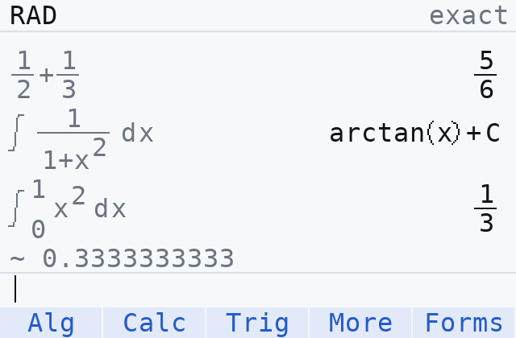

<div align="center">

  # MicroCAS

  <b>A computer algebra system with a textbook-style editor for the TI-84 EVO.</b>

  <p>
    
    
    
  </p>

  
</div>

## ✨ Features

- Exact arithmetic, radicals and complex numbers; huge powers stay exact (`3^(2^20)`)
- Simplify, expand, factor, partial fractions and equation solving
- Derivatives, limits, indefinite and definite integrals, Taylor series and sums
- Differential equations, gradients, arc length and polar/parametric areas
- MathPrint 2D editor with fraction, root, integral, sum and limit templates
- Scrollable history: copy any input or answer back, delete entries, switch answer forms
- Stored variables and functions, Ans, and argument help for every command

## 📦 Installation

1. Download `microcas-<tag>.zip` from the latest GitHub Release and extract it.
2. With [WebTILP](https://adriweb.github.io/tilibs/), send every `.8mp2` file to **Archive** and `CAS.8xpy2` to **RAM**.
   Or use the browser installer: download `microcas-web-installer` from the release's
   **Build calculator app** run and run `python serve_installer.py --directory website`.
3. Open the **Python** app and run **CAS**.

[docs/INSTALL.md](docs/INSTALL.md) covers the browser installer, removing an earlier version and first checks.

## ⌨️ Usage

| Key | Action |
|---|---|
| F1-F4 | Command menus: Alg, Calc, Trig, More |
| F5 or < > | Next form of the answer (exact, decimal, ...) |
| 2nd F1-F5 | All commands, templates, relations, setup, help |
| math | Command menu on the tab used last |
| 2nd + fraction | Template picker |
| ENTER | Evaluate; in the history, copy the selected input or answer |
| up | Scroll the history; left/right select the input or the answer |
| CLEAR | Clear the line, cancel a calculation, or delete the selected history entry |

## 🔨 Building

Requires Python 3.14 (desktop tooling), Node.js and the pinned MicroPython v1.12 `mpy-cross`.

```bash
python -m pip install -r requirements-dev.txt
python tests/support/lint.py src && python tests/support/framelint.py
python -m pytest -q -m "not slow" --strict-depth
python build/release.py
python build/archive.py --mpy-cross /path/to/pinned-v1.12/mpy-cross
node build/package_archive.mjs
python build/archive_zip.py        # dist/microcas-calculator.zip
```

Pushing a `v*` tag runs the [build workflow](.github/workflows/build.yml), which tests the
compiled packs on native MicroPython and attaches `microcas-<tag>.zip` to the tag's Release.

## 🤝 Contributing

Read [AGENTS.md](AGENTS.md) first: device code targets the calculator's Python 3.4 subset with
bounded call depth and heap. [docs/DESIGN.md](docs/DESIGN.md) describes the engine and
[docs/STATUS.md](docs/STATUS.md) records verified results and open checks. The repository keeps
its original name, cas-evo; releases before 1.0.2 were published under that name.
